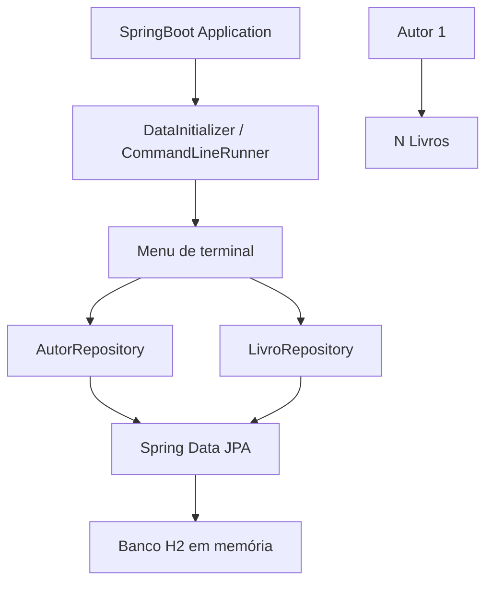

<div align="center">
  
</div>

<div align="center">

# S I S T E M A　B I B L I O T E C A　//　S P R I N G

### `JAVA 25 • SPRING BOOT 4.1.1 • JPA • H2`

**Gestão de autores e livros via menu interativo de terminal, com persistência JPA em banco H2.**


`FATEC • ADS`　·　`JAVA BACKEND`　·　`PROJETO ACADÊMICO`

[Visão geral](#visao-geral) · [Operações](#operacoes) · [Arquitetura](#arquitetura) · [Execução](#execucao)

</div>

---

<a id="visao-geral"></a>

## `PROJECT // VISÃO GERAL`

O **Sistema Biblioteca** utiliza Spring Boot e Spring Data JPA para cadastrar e gerenciar **autores e livros**. Sua interface de uso principal é um **menu de terminal** implementado por `CommandLineRunner`; não há controllers REST ou frontend próprio no código analisado.

Os dados são armazenados em **H2 em memória**, sendo perdidos quando a aplicação é encerrada. A aplicação habilita o **H2 Console** para inspecionar o banco durante a execução.

<a id="operacoes"></a>

## `SYSTEM // FUNCIONALIDADES REAIS`

| Menu | Operação |
| :---: | :--- |
| `01` | Cadastrar autor |
| `02` | Listar autores |
| `03` | Cadastrar livro vinculado a autor |
| `04` | Listar livros |
| `05` | Buscar livros por parte do título |
| `06` | Listar livros por autor |
| `07` | Atualizar título, ano e/ou autor de um livro |
| `08` | Excluir livro com confirmação |
| `09` | Exibir estatísticas de livros, autores e anos |
| `00` | Sair do menu |

**Estatísticas:** total de livros/autores, ano mais antigo, ano mais recente, média dos anos de publicação e quantidade de livros por autor, usando Java Streams e `Collectors.groupingBy`.

<a id="arquitetura"></a>

## `ARCHITECTURE // SPRING DATA JPA`



| Elemento | Responsabilidade |
| :--- | :--- |
| `SisbibliotecaApplication` | Inicialização da aplicação |
| `DataInitializer` | Menu e operações de negócio no terminal |
| `Autor` | Entidade JPA com relação `@OneToMany` |
| `Livro` | Entidade JPA com relação `@ManyToOne` |
| `AutorRepository` | Persistência e consultas de autores |
| `LivroRepository` | Persistência e consultas de livros |
| `application.properties` | Configuração do H2 e SQL exibido no terminal |

## `STRUCTURE // DIRETÓRIOS`

```text
Sistema-Biblioteca-Spring/
├── pom.xml
├── mvnw
├── mvnw.cmd
├── avaliacao_p1.pdf
└── src/main/
    ├── java/com/lab/jpa/sisbiblioteca/
    │   ├── SisbibliotecaApplication.java
    │   ├── config/DataInitializer.java
    │   ├── model/
    │   │   ├── Autor.java
    │   │   └── Livro.java
    │   └── repository/
    │       ├── AutorRepository.java
    │       └── LivroRepository.java
    └── resources/application.properties
```

<a id="execucao"></a>

## `BOOT SEQUENCE // COMO EXECUTAR`

**Pré-requisito:** **JDK 25**, conforme configurado no `pom.xml`. O repositório inclui o Maven Wrapper, portanto não exige Maven instalado globalmente.

```bash
git clone https://github.com/gilbertocorrea-cmd/Sistema-Biblioteca-Spring.git
cd Sistema-Biblioteca-Spring
chmod +x mvnw
./mvnw spring-boot:run
```

O menu aparecerá no **terminal**. Durante a execução, o H2 Console pode ser acessado em:

```text
http://localhost:8080/h2-console
JDBC URL: jdbc:h2:mem:testdb
User: sa
Password: (vazio)
```

> A opção `0` encerra o menu de texto; o processo Spring Boot pode continuar ativo. Use `Ctrl+C` para encerrar o servidor. O H2 em memória não preserva os dados após o encerramento.

## `TECH // TECNOLOGIAS`

`Java 25` · `Spring Boot 4.1.1` · `Spring Data JPA` · `Hibernate` · `H2 Database` · `Maven Wrapper` · `Lombok` · `CommandLineRunner` · `Java Streams`.

A atividade acadêmica original está disponível em [`avaliacao_p1.pdf`](avaliacao_p1.pdf).

---

<div align="center">

### `LIBRARY SYSTEM // CODE • LEARN • BUILD`

**Gilberto Corrêa** · Análise e Desenvolvimento de Sistemas — FATEC

[GitHub](https://github.com/gilbertocorrea-cmd)

</div>
